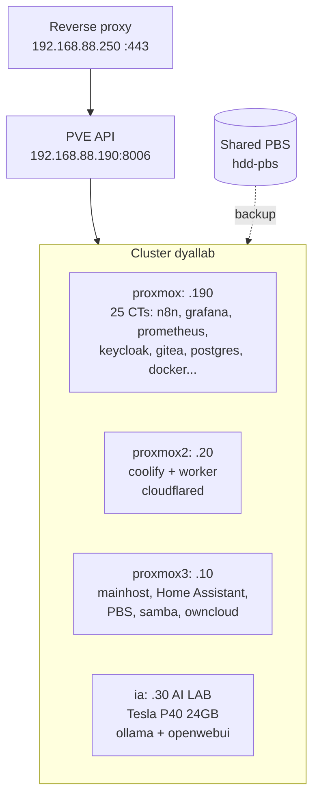

# Running LLMs at home with a Tesla P40: chronicle of a beautiful mess

> Or how I went from paying AI subscriptions to fighting drivers, PSUs, coolers and CUDA builds at 3 AM. And I regret nothing.

---

## Why would I want a local LLM?

Look, the idea was simple. Paying 20 dollars a month to every AI service had me fed up. ChatGPT, Claude, whatever else. And everything goes through someone else's cloud.

So I got the idea of the **home AI Lab**: build a box at home, run open-weight models there, benchmark them, and use them to generate code, automate dumb tasks, experiment.

The repo where I wrote everything down is [jd-llm](https://github.com/jd-apprentice/jd-llm). At first it was just a `bench.sh` and a couple of READMEs. It ended up as a war diary against a 2016 GPU.

If you care about the pure technical side, go straight to `BENCHMARKS.md` and `scripts/bench.sh`. This is the human story behind them.

## The hardware

What I have running Proxmox 9 today:

```sh
OS: Proxmox 9
Kernel: Linux 7.0.14-15-pve
CPU: AMD Ryzen 5 3400g
GPU: NVIDIA Tesla P40
Memory: 8GB DDR4 2400 MHz x2
```

And the shopping list from [issue #1](https://github.com/jd-apprentice/jd-llm/issues/1), which is basically my grocery list but nerdier:

- Storage Shelf (50 USD)
- NVIDIA Tesla P40 (350 USD)
- RJ45 Cat 5e (5 USD)
- Carry Disk 2.5 USB 3.0 x1 (20 USD)
- Power Cable (15 USD)
- PSU Corsair 750w (150 USD)
- B450M Gaming Pro + Ryzen 5 3400g (free, rescued)

So for less than 600 dollars you build a lab that runs models from 1B to 35B locally. Sounds nice, right? Well, hold on.

The lab already existed before; the 50 dollar shelf was an upgrade for more space and to organize the mess:


And with the hardware up, it was already taking shape as a real AI Lab:


## Where it all runs: the dyallab cluster

Note that it is not a single machine. I have a Proxmox cluster (`dyallab`, PVE 9.2.6) with 4 nodes, 6 VMs and 32 containers. The P40 lives in only one of them. This is how it looks today, polled through the API:



- **proxmox (.190)**: the one that works every day. 25 containers with the whole stack: n8n, grafana, prometheus, loki, influxdb, keycloak, lldap, authelia, gitea, postgresql, docker, romm, searxng, stirling-pdf and more. The openwebui that lives here (117) is turned off; the one that matters is on the `ia` node.
- **proxmox2 (.20)**: coolify (106) + coolify-worker-1 (129) and cloudflared (110) to expose things.
- **proxmox3 (.10)**: mainhost (108), Home Assistant (109), the Proxmox Backup Server (103) and samba/owncloud.
- **ia (.30)**: the AI Lab itself. Ryzen 5 3400G, 16GB RAM, and the P40 plugged in (`GP102GL [Tesla P40]` according to the PCI). This is where CT 127 `ollama` (4c/4G) and 128 `openwebui` (4c/8G) live, plus a VM 112 `veloren` running (a little game server on the AI node; nobody knows anything, nobody saw anything 🤫).

The only shared storage across the 4 is `hdd-pbs` (backups). Everything else is local to each node.

## The P40: cheap for a reason

The Tesla P40 is a beast: 24GB of VRAM, Pascal, `sm_61`, built for the datacenter. You can find it on eBay for 350 dollars because datacenters throw them away. 24GB for that money does not exist in a gaming card.

But it is cheap for a reason. It is a board **with no cooler, no video output, nothing**. It is a brick that throws 250W of heat and expects the server it sits in to blow air at it with airplane turbines.

I do not have a server. I have a Proxmox at home.

### 1. The ghetto cooling

I open [issue #11](https://github.com/jd-apprentice/jd-llm/issues/11): "Cooling solution for the Tesla P40".

My current solution is literally a standing fan pointed at the GPU. Airflow from "close to front". With the fan on 1 or 2, temps stay at 90 degrees. Not the best, but it works before the 3D enclosure.

Still missing: the 3D printed enclosure + a real fan. It is on the "Missing" list. Meanwhile, Argentine summer + P40 at 90 degrees = free sauna.

### 2. The PSU could not take it

The GPU arrives, everything happy, photo for the issue. I hold it in my hand, it is a beautiful brick:


I plug it in... and the machine does not boot.

Confirmed: **my PSU cannot take the P40**. Weird ping, no SSH, random delays. I had to buy a 750w Corsair (150 dollars, the most expensive thing after the GPU). Plus a motherboard + CPU with iGPU so I could have video while I fought with it.

Because that is another topic:

### 3. It is headless, so you are blind

The P40 has no HDMI, no DisplayPort, nothing. If your CPU also has no iGPU (like a Ryzen 5 2600), you are **blind**. The motherboard does the VGA check, there is no image, "blind boot".

I documented it in [issue #10](https://github.com/jd-apprentice/jd-llm/issues/10):

> when using the P40 computer won't start properly, I can ping it but there is no ssh service and since I don't have any sort of image I can't plug a monitor.

I tried sending logs through grub + rsyslog to debug blind. It did not even reach systemd. A total pain in the ass.

The temporary solution: use an APU (the 3400g has an iGPU) to have video. But that brought the next problem...

### 4. PCIe x8 instead of x16, the APU trap

I run `nvidia-smi -q | grep -A15 -i "PCI"` and see:

```
Link Width
    Max     : 16x
    Current : 8x
```

What do you mean x8?? The P40 is x16.

Turns out Ryzen G CPUs (APU, with integrated graphics) **physically only give you 8 PCIe lanes to the main slot**. The other lanes are eaten by the iGPU. No BIOS fixes it, it is silicon. You either have integrated video or full bandwidth. You cannot have both.

The internal VRAM still runs at 346 GB/s, but the CPU to GPU link is cut in half (~8 GB/s instead of 16). That hits tokens per second directly when the prompt is large. I measured it, I suffered it.

I chose to keep the APU for now because I prefer to see what is happening over 5% more throughput. I will migrate when I have a cheap video card for debugging.

### 5. Driver hell: 610 open vs 580 proprietary

This was the final boss. You install the P40, run `nvidia-smi` and it spits:

```
NVIDIA-SMI has failed because it couldn't communicate with the NVIDIA driver.
```

I was on driver `610.57.04` with the **open** module. And there is the trap: the open module only supports GPUs with GSP (Turing and up). The P40 is Pascal, it has no GSP. `dmesg` tells you to your face:

```
NVRM: ... is not supported by open nvidia.ko because it does not include
the required GPU System Processor (GSP).
```

Also the 610 branch already dropped Pascal entirely. The **last branch that supports Pascal is 580**, which goes up to CUDA 13.0.

What I had to do, all by hand:

```bash
# blow away 610
dkms remove nvidia/610.57.04 --all
apt-get remove -y --purge nvidia-driver nvidia-driver-cuda nvidia-kernel-open-dkms

# install 580 proprietary with DKMS
./NVIDIA-Linux-x86_64-580.178.04.run --silent --dkms --no-opengl-files
update-initramfs -u -k all
```

Only then:

```
|   0  Tesla P40   ...   0MiB /  23040MiB |
```

31 degrees, 45W idle. I cried a little.

### 6. Compile llama.cpp because you have no choice

I thought "done, that's it". No. Now comes CUDA.

- CUDA Toolkit **13.x dropped support for sm_61** (everything before sm_70 is out).
- The 580 driver supports up to CUDA 13, but to compile for Pascal you need CUDA **12.8**.
- The `llama.app` installer only ships builds against the newest CUDA, whose minimum driver the 580 does not meet. So its probe fails silently and you fall back to a **CPU-only binary**. You think you are on GPU and you are on CPU. Beautiful.

Solution: build from source, branch `b10826`:

```bash
git clone --depth 1 --branch b10826 https://github.com/ggml-org/llama.cpp
cmake -B build \
  -DGGML_CUDA=ON \
  -DCMAKE_CUDA_ARCHITECTURES="61" \
  -DCMAKE_BUILD_TYPE=Release
cmake --build build --target llama-app -j 2
```

Details that cost me hours:

- `-j 2` because with 4GB of RAM the CUDA compile dies.
- Then `cp build/bin/llama-server ~/.local/bin/` + copy the `.so*` to `/usr/local/lib` + `ldconfig`.
- **NEVER run `llama update` again**, it overwrites the CUDA build with the CPU-only one.
- Sanity check: the log has to say `CUDA0: Tesla P40`, and `curl http://<host>:8080/health` has to respond.

Once you see that `CUDA0: Tesla P40`, you are golden.

## The benchmarks: GTX 1660 vs P40, no contest

The `bench.sh` today is server-only. It does no local inference, it only hits `POST /completion` on the `llama-server` that is already running with the model loaded (`-c 8192`), with an exact token-id prompt, `cache_prompt: false`, `ignore_eos: true`, and measures `.timings`.

9 fixed tests, in order: `pp1024+tg16, pp4096+tg256, pp2048+tg256, pp2048+tg768, pp1024+tg1024, pp1280+tg3072, pp384+tg1152, pp64+tg1024, pp16+tg1536`.

Let me give you an example so your jaw drops. Llama 3.2 1B Q4_K_M:

**GTX 1660 6GB:**
`pp1024+tg16 | 6.36s | PP 163 t/s | TG 166 t/s | TTFT 6.27s`

**Tesla P40 24GB:**
`pp1024+tg16 | 310ms | PP 4340 t/s | TG 194 t/s | TTFT 230ms`

You read that right. From 6 seconds to 300 milliseconds on prompt processing. TTFT went from 6 seconds to 0.23. Generation improves too, but where the P40 destroys you is prefill.

With small models (Qwen 0.8B, Gemma 1B, FableForge 1.5B) it is the same story. And with 7-9B models (Qwen2.5 7B, Ornith 9B, Bonsai 27B Q1_0) the 1660 crawls or needs offload with an NGL sweep, while the P40 does not even flinch with 23GB free.

We went from "hey, it works" to "hey, this is actually usable for work".

All validated with `shellcheck` in CI + a pre-commit hook that validates the `BENCHMARKS.md` format (H3 titles, columns, test order). Because if we are going to suffer, let's suffer in order.

## What is it for? The examples

The best part: with a `qwen3.6:35b-a3b` running locally through Ollama, I generated entire projects without calling any API:

- **veterinary-web**: a veterinary landing page with React 19 + Tailwind + Vite, deployed at [local-llm-example-1.jonathan.com.ar](https://local-llm-example-1.jonathan.com.ar)
- **retro-games**: an arcade catalog with pixel fonts, glow, scanlines, and even 5 playable little games (PacMan, Tetris, SpaceInvaders...), at [local-llm-example-2.jonathan.com.ar](https://local-llm-example-2.jonathan.com.ar)
- **todo-list**: a Bash CLI (`./todo.sh add/list/done/ai`) with an AI assistant through `http://localhost:11434`

All of that came out of a model running at home, in Proxmox, with a standing fan next to it. If that is not Argentine cyberpunk, I do not know what is.

And the ideas left in [issue #5](https://github.com/jd-apprentice/jd-llm/issues/5) are the ones that excite me most: automate WhatsApp for dyabox, scrape Zonaprop, auto-reply to GitHub tickets, plug SearXNG into the agents, play with OpenWebUI / AnythingLLM / n8n. Now that the GPU works, that part is coming.

## Closing: is it worth it?

Honestly, yes. But with eyes open:

**The good:**

- 24GB VRAM for 350 USD does not exist anywhere else.
- Total privacy, zero cost per token, experiment without fear.
- You learn a ton: PCIe, drivers, CUDA, llama.cpp, real benchmarks.

**The bad:**

- It is datacenter hardware in a home case. It heats, makes noise, draws 250W.
- No cooler, no video, old driver, old toolkit, compile everything by hand.
- You need Linux chops. Proxmox + DKMS + initramfs is not for everyone.

If you ask me whether I would do it again: obviously. Every time I see `CUDA0: Tesla P40` in the log and a model spitting 190 t/s next to my bed, with the little fan in the background, I think "what a beautiful mess I built".

And this is the current state of the disaster, face to face, cables everywhere but working ([photo from the issue](https://github.com/jd-apprentice/jd-llm/issues/1#issuecomment-5753642077)):


And I still need the 3D enclosure. When I have it, I close issue #11 and open a bottle of champagne.

---

*Stack: Proxmox 9, Tesla P40 24GB, Ryzen 5 3400g, llama.cpp b10826 (CUDA 12.8, sm_61), driver 580.178.04 proprietary, bench.sh server-only. All tracked in [jd-llm](https://github.com/jd-apprentice/jd-llm).*
