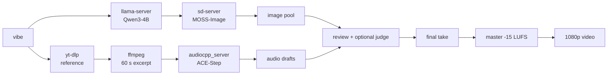

# From the first video to a local studio: 8-bit music and thumbnails with local models

> On November 18 I published the channel's first video. I built it by hand with Suno, MOSS-Image and a pile of prompts. A few days later, the next one is no longer hand-made: it comes out of a Rust TUI that talks to three services in my house. This is the story of that jump.

---

## The first video

The video is [late night 8-bit gaming & chill](https://youtu.be/wqZnoVyLDG0). It runs 3:23 and went live on November 18. By then the lab was already standing: the Tesla P40 in Proxmox, `llama.cpp` compiled for Pascal and `stable-diffusion.cpp` with MOSS-Image. `audio.cpp` was the next experiment.

The first video was still handmade:

- **Thumbnail:** MOSS-Image through `stable-diffusion.cpp`, with a prompt I wrote by hand.
- **Music:** Suno. Yes, the cloud. The local pipeline was not ready for production yet.
- **Prompts and copy:** local `Qwen3.6-35B-A3B`, which I already used for code and for writing nonsense.
- **Edit:** ffmpeg, a still, a fade and publish.

It worked. The video looked good, the thumbnail matched the vibe and the channel was off the ground. But the music side still depended on a subscription and on a service I did not control.

And I had a 24 GB P40 sitting idle.

## The math did not add up

The point of the lab was never to benchmark models forever. It was to use the GPU for something concrete. I had already generated landing pages and small games with local Qwen, and I had already measured how the P40 crushes a GTX 1660 on prefill. The creative side was missing.

Generating music is not like generating a landing page. A pretty prompt is not enough: you need duration, structure, mixing, loudness and a result that does not sound like a demo loop. And if you also want a matching thumbnail, the flow turns into a puzzle of four tools that do not talk to each other.

So I did what people with a homelab do: I started testing by hand and writing everything down.

## The experiment era

The first step was building [`audio.cpp`](https://github.com/0xShug0/audio.cpp) on the GPU host VM. It was not trivial:

- CUDA 12.4 because the P40 is `sm_61` and CUDA 13 dropped it.
- GCC 13, because CUDA 12.4 rejects newer host compilers.
- An explicit `--cuda-arch 61`.
- A build of about 13 minutes on 4 vCPU.

With `audiocpp_server` running, I started generating ACE-Step 1.5 takes. The first tests were 10 and 60 seconds with Magenta RealTime and the Turbo checkpoint. Then came the long 190 to 210 second takes to see if they could carry a YouTube track.

Everything went into the take log (`audio-takes.md`, now in the channel repo): model, steps, CFG, sampler, seed, length and wall time. That file is what helped me understand what each decision was buying.

Some numbers from it:

| Configuration | Length | Time on the P40 |
| --- | --- | --- |
| Turbo, 8 steps | 190 s | ~50 s |
| Base, 32 steps, CFG 5, heun | 190 s | ~302 s |
| Base, 50 steps, CFG 7, heun | 190 s | ~577 s |
| XL-SFT q8dit, 32 steps, CFG 5, heun | 190 s | ~742 s |

The first lesson: **Turbo is for drafts**. With 8 steps and no CFG it is enough to decide whether an idea works, but not enough to publish. The second: cost grows linearly with steps times CFG, so quality is paid for in GPU minutes.

## The loop problem

ACE-Step takes end with a fade-out, and long descriptions add an intro. If you cut the file anywhere and crossfade it with the beginning, you hear the seam. If you use a long crossfade, it eats the rhythm.

The recipe that stayed in the manual script:

1. Detect tempo by folding the onset envelope between 70 and 180 BPM.
2. Start and end on a bar line.
3. Among the bar-aligned lengths between 150 and 190 seconds, pick the one whose end spectrum best matches the start spectrum.
4. Crossfade 50 ms and normalize the peak to -1 dBFS.

For takes with an intentional intro and outro the recipe is different: keep both ends and crossfade the last 3 seconds of the outro into the first 3 seconds of the intro. Both edges are sparse, so the blend reads as a breath instead of a jump.

## The reference is not the song

Another thing I learned: passing a reference track to ACE-Step does not turn it into a cover. The model samples three 10 second windows and uses them to condition timbre and style.

The take that helped the most was take I, with a Suno reference. The Welch PSD comparison showed why the first takes sounded wrong:

| Signal | Centroid | Low (<200 Hz) | Mid (200-2k) | High (2-8k) |
| --- | --- | --- | --- | --- |
| Suno reference | 598 Hz | 47% | 48% | 4% |
| Take G (base, no reference) | 882 Hz | 72% | 18% | 8% |
| Take I (base + reference) | 782 Hz | 47% | 46% | 5% |

Take G had 72% of its energy below 200 Hz. The melody was buried and the mix sounded broken. Take I matched the reference balance almost exactly. I then mastered it to -15 LUFS with `loudnorm=I=-15:TP=-1.5`, and it landed at -15.19 LUFS.

That was the moment I understood that the pipeline could be automated, but the mixing decisions could not.

## melodias-studio is born

With the recipes proven, the next step was to stop copying and pasting commands. That is how [`melodias-studio`](https://github.com/melodias8bit/melodias-studio) appeared: a Rust TUI and CLI that runs the eleven pipeline stages against the local services.

A full run:

1. The local LLM turns the vibe into an English image prompt. The pixel-art style is pinned in the system prompt, not left to the vibe.
2. `sd-server` renders 3 candidates at 1280x720 and 20 steps.
3. `yt-dlp` downloads a reference and `ffmpeg` keeps its most energetic minute.
4. ACE-Step records 3 sixty second drafts with that reference.
5. The TUI pauses on a review screen to pick one image and one draft. In headless mode, an optional multimodal judge preselects the pair.
6. ACE-Step records the 210 second final take from the chosen seed.
7. `ffmpeg` masters with fades and `loudnorm` to -15 LUFS.
8. Remotion assembles the 1080p video with a slow zoom, waveform, particles and branding.

Everything lands in `output/<slug>/`: `thumbnail.png`, `audio.mp3`, `video.mp4`, `meta.json`, `candidates/` and `work/`.

## The judge, the score and the retry loop

One of my favorite parts is the one that decides whether the result is good enough.

First there is an **optional judge**: it sends the thumbnails and 15 second clips to a multimodal model and returns a suggested pair with a reason. Without an API key the judge is skipped and the manual review still works. It never blocks a run.

Then there is a **deterministic score**, with no GPU and no cloud:

- Image: palette, contrast at 168 px, text, glow and saturation.
- Audio: loudness, true peak, spectral centroid, energy above 5 kHz, build, silence and length.
- Total: 60% technical and 40% editorial (the judge verdict, when it exists).
- A run is accepted at 80 total, 85 technical and 70 editorial.

If one side misses, the retry loop patches the prompt and regenerates only that side. The image side gets up to 2 rounds and the audio side 1. The same patch never runs twice, and the pool stops at 9 candidates per side so the review still fits the 1-9 keys.

A run that misses the target is not discarded: it is saved as `accepted_by_limit`, and the log says which side exhausted its budget. I find that more honest than pretending everything came out perfect.

## The real numbers

On the P40, with the single-card setup:

| Stage | Time | Notes |
| --- | --- | --- |
| Pool of 3 thumbnails | ~13.9 min | 20 steps, ~4.6 min per image |
| Pool of 4 thumbnails with retry | ~23.5 min | includes one `IMG_PALETTE` round |
| Audio drafts | ~1 min per draft | 60 s, 16 steps, euler |
| Final take | 5 to 10 min | 210 s, 32 steps, CFG 5, heun |
| Master | seconds | ffmpeg, -15 LUFS |
| Remotion video | ~12 min | ~121 MB, 1080p |
| ffmpeg video | ~2 min | ~42 MB, 1080p |

A full run with review and video takes on the order of an hour. It is not instant, but it runs while I do something else and it does not depend on any paid API in the critical path.

## What I learned

- **The reference conditions timbre, not melody.** If you want a cover, this is not the path.
- **The medium belongs in the style, not the vibe.** If you leave "8-bit" to the user prompt, sooner or later you get a 3D render with a retro filter.
- **Eyes are a prompt problem.** The 4B model wrote "glowing red eyes" for anything dramatic. The fix was to ask for natural eyes with a visible iris and pupil, plus a specific negative prompt.
- **The audio server lies about duration.** You ask for 60 seconds and get 129 because the planner picks the length. The CLI does respect `--duration-seconds`.
- **ACE-Step only reads the nested `options` object.** If you send `duration_sec` or `reference_audio` at the top of `request`, they are dropped silently.
- **Turbo does not accept more than 8 steps.** Extra steps only cost time, not quality.
- **The score is not taste.** It catches broken palettes, audio without highs or thumbnails with unreadable text. The final decision is still human.
- **Pascal forces you to compile.** CUDA 13, the llama.app installer and new drivers leave you on CPU without warning. I covered that in the [previous post](https://github.com/jd-apprentice/jd-llm/blob/main/blog/corriendo-llms-tesla-p40.md).

## What is next

The [roadmap](https://github.com/melodias8bit/melodias-studio/blob/main/docs/roadmap.md) has several things I want:

- Generate without a reference track, from the vibe alone.
- Cancel a run in progress and retry a single stage.
- Use the video title to name the output folder.
- Write the video entry straight into the channel content repo.
- Compare two takes side by side before picking one.
- Add the five editorial axes from RFC 0002, which are still half done.

Meanwhile, the channel keeps going. The first video was handmade; the next one comes out of a studio running in my house, with a 2016 GPU, a standing fan and three HTTP services passing the work around.

If that is not Argentine cyberpunk, I do not know what is.

## Links

- Channel: <https://www.youtube.com/@melodias8bit>
- Organization: <https://github.com/melodias8bit>
- Studio: <https://github.com/melodias8bit/melodias-studio>
- Lab and benchmarks: <https://github.com/jd-apprentice/jd-llm>
- Lab map for the pipeline: [docs/melodias-studio-local-lab.md](https://github.com/jd-apprentice/jd-llm/blob/main/docs/melodias-studio-local-lab.md)
- Channel content: <https://github.com/melodias8bit>

---

*Stack: Tesla P40 24 GB on a Proxmox VM, llama.cpp with CUDA 12.8 and `sm_61`, stable-diffusion.cpp with MOSS-Image, audio.cpp with ACE-Step 1.5, melodias-studio in Rust, ffmpeg and Remotion. All local except the optional judge.*
