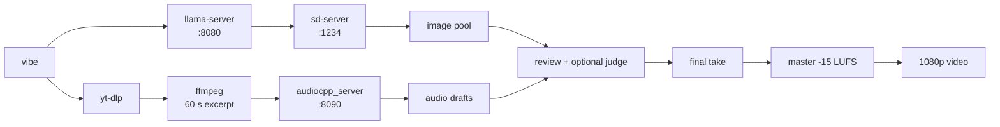

# Melodias8bit on the local lab

How [melodias-studio](https://github.com/melodias8bit/melodias-studio) turns a vibe and a reference URL into a thumbnail, a track and a 1080p video using the services already running in this lab.

The studio repository is the source of truth for flags, config keys and behavior. This page maps its pipeline to the hardware, the three HTTP services and the operational details of this setup.

## Where each piece runs

| Piece | Host | Role |
| --- | --- | --- |
| `melodias` binary | Workstation | TUI, headless run, review, scoring, video assembly |
| `llama-server` | GPU host | Writes the image prompt from the vibe |
| `sd-server` | GPU host | Renders the thumbnail candidates with MOSS-Image |
| `audiocpp_server` | GPU host | ACE-Step drafts and the final take |
| `yt-dlp` + `ffmpeg` | Workstation | Reference download, excerpt, mastering |
| Remotion (`pnpm`) | Workstation | Default 1080p video renderer |

The GPU host is a VM on the Proxmox node `ia` (the node itself is `192.168.88.30`) with the Tesla P40 passed through. The studio defaults to `root@192.168.88.38`, which is a DHCP lease and can change. Check the current address before a run, or set `SSH_HOST`.

The standalone benchmark client in this repo defaults to a different address (`192.168.88.33:8080`), so override it explicitly if you want to hit the studio host:

```bash
./scripts/bench.sh --server http://192.168.88.38:8080 --gpu-label "Tesla P40 (23040 MiB)"
```

## Services and VRAM

The example deployment in `melodias-studio/deploy/env.sh` runs three services on the same card:

| Service | Port | Model | Approx. VRAM | Used by |
| --- | --- | --- | --- | --- |
| `llama-server` | 8080 | `Qwen3-4B-Instruct-2507-Q4_K_M` | 3.4 GB | Stage 1, image prompt |
| `sd-server` | 1234 | MOSS-Image `UD-Q4_K_XL` + `Qwen3.5-9B-Q8_0` + VAE | 11.4 GB | Stage 3, image pool |
| `audiocpp_server` | 8090 | ACE-Step 1.5 Turbo bf16 | 10.1 GB model, ~14.7 GB session with `mem_saver` | Stages 7 and 9, audio |

The order matters. The LLM and `sd-server` can hold the card at the same time, so the image stage keeps both up. The audio stage stops `sd-server` and the LLM, because ACE-Step with a timbre reference needs the whole card. `deploy/audio-server.json` enables `ace_step.mem_saver` so the session returns to about 14.7 GB between requests instead of staying at the peak.

Pascal constraints still apply: CUDA 12.x toolkit, `sm_61`, no CUDA graphs. Build `audio.cpp` with GCC 13 and `--cuda-arch 61`; the deployment scripts assume the binaries are already installed.

## Pipeline

The studio runs eleven stages:

1. Image prompt: the LLM writes an English prompt from the vibe. The pixel-art medium is pinned in the system prompt.
2. Prepare image: stop the LLM, start `sd-server`.
3. Image pool: three candidates at 1280x720 and 20 steps, with optional reference images.
4. Download: `yt-dlp` fetches the reference track.
5. Reference: `ffmpeg` keeps the 60 s window with the most energy.
6. Upload: the reference goes to `remote_ref_dir` on the GPU host.
7. Audio drafts: three 60 s takes from ACE-Step with `reference_audio`.
8. Review: manual pick in the TUI, or the optional judge suggestion in headless mode.
9. Final take: ACE-Step records the full length from the chosen draft seed.
10. Master and save: fade in, fade out and `loudnorm` to -15 LUFS, 320 kbps MP3.
11. Video: Remotion by default, ffmpeg when requested explicitly.

The reference only conditions timbre and style. The thumbnail and the track are new material, not a conversion of the source.



## Configuration

Copy `config.example.toml` to `~/.config/melodias-studio/config.toml` and set the endpoints and lifecycle commands. Environment variables win over the file, and every value has a default.

```toml
llm_url = "http://192.168.88.38:8080"
sd_url = "http://192.168.88.38:1234"
audio_url = "http://192.168.88.38:8090"
audio_model = "ace-step"

ssh_host = "root@192.168.88.38"
remote_ref_dir = "/models/ref"

llm_start_cmd = "/home/ubuntu/bin/serve-llm.sh start"
llm_stop_cmd = "/home/ubuntu/bin/serve-llm.sh stop"
sd_start_cmd = "/home/ubuntu/bin/serve-sd.sh start"
sd_stop_cmd = "/home/ubuntu/bin/serve-sd.sh stop"
audio_start_cmd = "/home/ubuntu/bin/serve-audio.sh start"
audio_stop_cmd = "/home/ubuntu/bin/serve-audio.sh stop"

image_style = "8-bit pixel art"
audio_style = "8-bit chiptune"
duration_sec = 210
steps = 32
guidance = 5.0
sampler = "heun"
video_renderer = "remotion"
```

To run everything on one machine, set `ssh_host = ""` and empty the lifecycle commands. Empty environment variables are ignored, so `SSH_HOST=` does not switch to local mode. It has to be set in the file.

## Deploy and run

```bash
cd melodias-studio
make deploy          # copy env.sh, serve-*.sh and audio-server.json to the GPU host
make install         # build and copy ~/.local/bin/melodias
melodias             # TUI
```

Headless:

```bash
MELODIAS_LOG=output/run.log \
  melodias 'https://www.youtube.com/watch?v=...' 'epic 8-bit orchestral finale'
```

A finished run leaves:

```text
output/<slug>/
├── audio.mp3
├── thumbnail.png
├── video.mp4
├── meta.json
├── candidates/
└── work/
```

The full command list and the review, judge, score, retry, history and dashboard flows live in the studio docs: [usage](https://github.com/melodias8bit/melodias-studio/blob/main/docs/usage.md), [configuration](https://github.com/melodias8bit/melodias-studio/blob/main/docs/configuration.md) and [architecture](https://github.com/melodias8bit/melodias-studio/blob/main/docs/architecture/README.md).

## Review and quality gates

- The optional judge sends the thumbnails and 15 s clips to a multimodal model and preselects a pair. It fails open: without a key, the manual review still works.
- `melodias score` applies a deterministic rubric to a finished run: palette, contrast, text, glow and saturation for images; loudness, true peak, spectral centroid, high-frequency energy, build, silence and length for audio.
- A run is accepted at 80 total, 85 technical and 70 editorial. The retry loop patches the prompt and regenerates only the side that missed, up to 2 image rounds and 1 audio round.
- A run below target after the loop is kept and marked `accepted_by_limit`, not discarded.
- `melodias history` and `melodias dashboard` read the local SQLite database and never modify the run.

## Gotchas

- ACE-Step reads the nested `options` object. `duration_sec`, `reference_audio`, `sampler_mode` and `negative_prompt` at the top level of `request` are silently dropped.
- With `duration_sec` inside `options` the server returns an exact length. Without it, the planner picks the take length (asking for 60 s returned 129 s). The CLI with `--duration-seconds` is the other exact path.
- Use the ACE-Step bf16 package. The `q8_0` package fails planner sampling.
- `turbo` and `xl-turbo` are guidance-distilled: steps cap at 8 and `guidance_scale` is ignored. `base` and `xl-sft` take the CFG path.
- `bpm` and `keyscale` are ignored by the planner. Tempo and mood have to go in the text.
- Remotion is the default and needs Node, pnpm and `video/node_modules`. It takes about 12 minutes and writes a ~120 MB file. `melodias video` or `VIDEO_RENDERER=ffmpeg` is the explicit fast path (about 2 minutes, ~42 MB).
- The reference file has to live on the GPU host. `AUDIO_REFERENCE` replaces the downloaded window with a curated loop.

## Manual path

The channel catalog, the manual image and audio recipes and the take log moved to the [melodias8bit](https://github.com/melodias8bit) org. This page keeps the lab mapping and the service contract.

For the narrative version of the same pipeline, see [From the first video to a local studio](../blog/from-first-video-to-a-local-studio.md).
