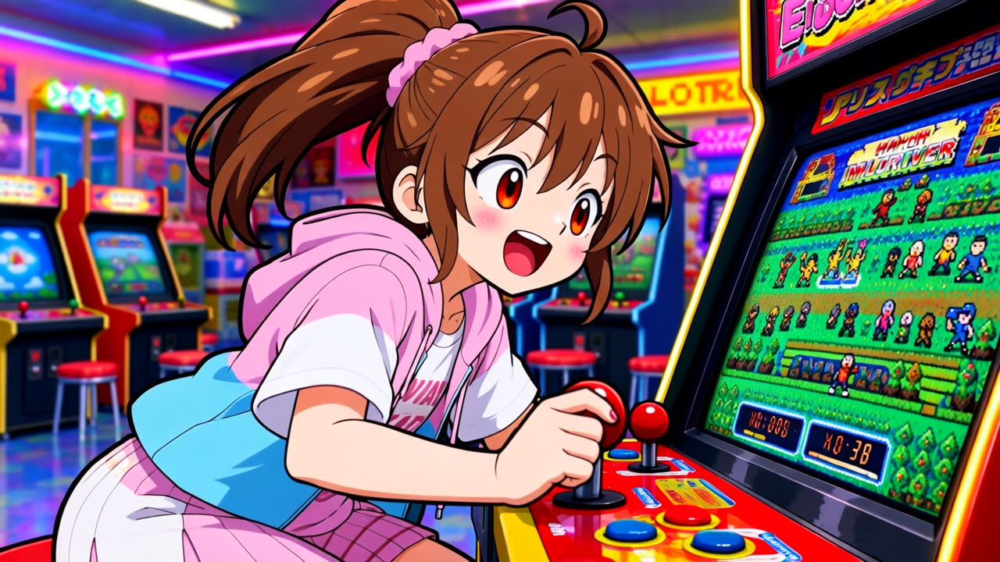

# 02 · Arcade room



- **Title:** synthwave & chiptune tunes to study / relax to 🕹️✨
- **Status:** thumbnail and audio ready
- **Music:** synthwave + chiptune, 123.75 BPM, 3:24 seamless loop
- **Seed:** 45605460
- **Files:** `assets/thumbnails/02-arcade-room.png`, `assets/audio/02-arcade-room.mp3`

## Concept

A smiling girl in an arcade room surrounded by classic arcade machines.

## Prompt

```text
An energetic anime girl playing an arcade machine, colorful neon lights, vibrant pixel art style, retro arcade room background, holding a game controller, expressive cute face, 16:9 aspect ratio, eye-catching YouTube thumbnail
```

## Audio

- Model: ACE-Step 1.5 `base` (bf16), 32 steps, CFG 5, `heun`, 210 s take, seed 45605460.
- `reference_audio` pointed at a Suno reference track, which brought the mix to 47% low / 46% mid instead of the 72% low the first attempts had.
- Mastered at -15 LUFS with a -1.5 dB true peak.
- Loop keeps the generated intro and outro and crossfades the last 3 s of the outro into the first 3 s of the intro.
- Every take and the full recipe live in [`audio-takes.md`](../audio-takes.md).

## Notes

- Heavy neon scene: check that thumbnail text (if any) does not fight the background.
